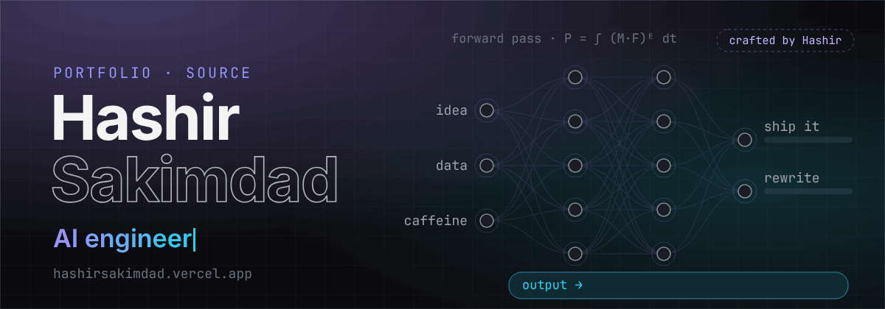
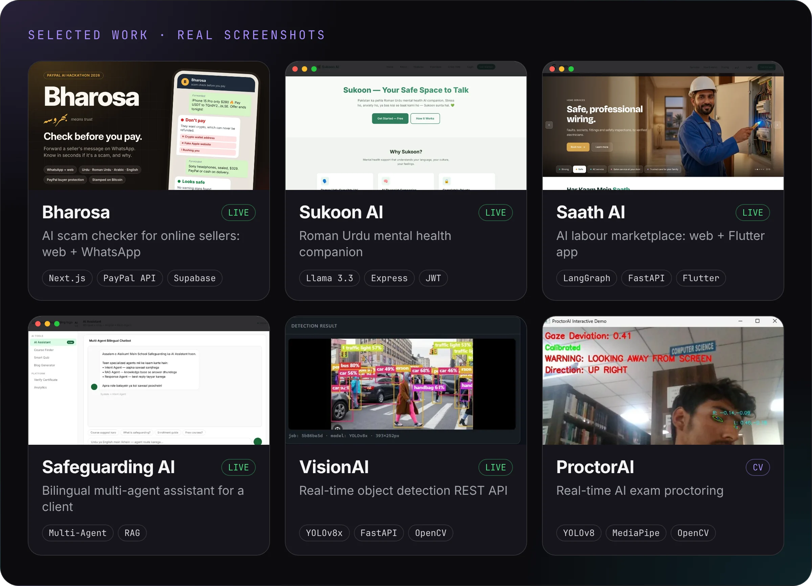
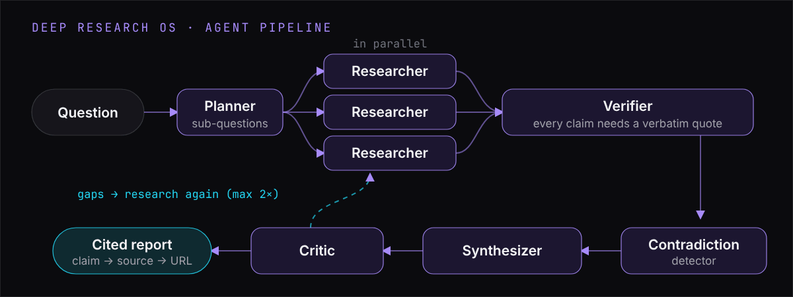
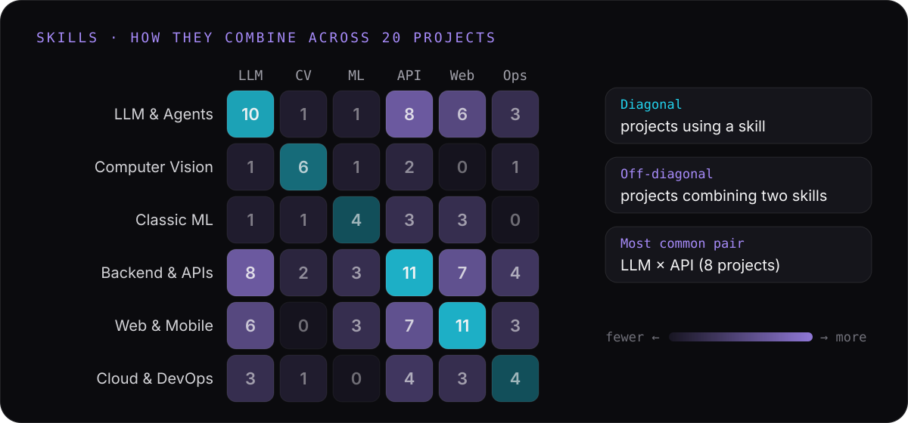
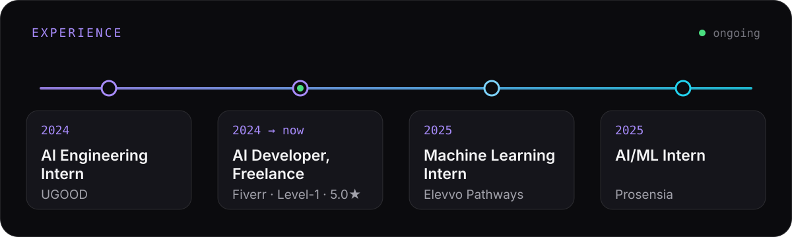

<p align="center">
  <a href="https://hashirsakimdad.vercel.app">
    
  </a>
</p>

<p align="center">
  <a href="https://hashirsakimdad.vercel.app"><b>Visit the live portfolio →</b></a>
  &nbsp;·&nbsp;
  <a href="https://linkedin.com/in/hashir-sakimdad-8bbb22299">LinkedIn</a>
  &nbsp;·&nbsp;
  <a href="https://github.com/hashirsakimdad">GitHub</a>
  &nbsp;·&nbsp;
  <a href="https://fiverr.com/hashirsakimdad">Fiverr</a>
</p>

This repo is the source of my portfolio: one hand-built page that shows the AI products I've shipped, with agents, RAG and computer vision running for real users.

## Selected work

<p align="center">
  
</p>

| Project | What it does | Link |
| --- | --- | --- |
| **Bharosa** | AI scam checker for online sellers, on the web and WhatsApp | [Live](https://bharosa-two.vercel.app) · [Code](https://github.com/hashirsakimdad/Bharosa) |
| **Sukoon AI** | Roman Urdu mental health companion | [Live](https://sukoon-ai-nine.vercel.app) · [Code](https://github.com/hashirsakimdad/sukoon-Ai) |
| **Saath AI** | AI labour marketplace with a web app and a Flutter app | [Live](https://saath-ai-7o3horpxkq-el.a.run.app/app/) |
| **School Safeguarding AI** | Bilingual multi-agent assistant for a client | [Live](https://school-safeguarding-ai-suite.vercel.app) |
| **VisionAI** | Real-time object detection REST API | |
| **ProctorAI** | Real-time AI exam proctoring | |

The site lists 14 more projects, with filters.

## How one of them works

**Deep Research OS** is a multi-agent research system. Six agents plan, research in parallel, verify every claim against a quote, flag contradictions and write a cited report. A critic sends the report back for more research when it finds gaps.

<p align="center">
  
</p>

## Skills

Each cell counts how many of my 20 projects use both skills. The diagonal shows how many use each one.

<p align="center">
  
</p>

## Experience

<p align="center">
  
</p>

## Inside this repo

A static site with no build step: plain HTML, CSS and JavaScript.

| Path | What's there |
| --- | --- |
| `index.html` | All sections: hero, about, skills, services, experience, projects, case studies, contact |
| `assets/css/style.css` | Styles and responsive layout |
| `assets/js/main.js` | Animations (GSAP + ScrollTrigger + Flip, Lenis smooth scroll), the neural canvas, the skills matrix and the contact form |
| `assets/js/vendor/` | Bundled GSAP and Lenis, so there's no CDN dependency |
| `assets/img/` | Project screenshots |
| `assets/readme/` | The images in this README. The `.svg` files are the editable sources for the GIFs. |

All animation respects `prefers-reduced-motion`, and the page still works if the scripts fail to load.

## Run it locally

```bash
npx serve .
```

Then open the URL it prints. You can also open `index.html` directly in a browser.

## Deploy

Pushing to `main` deploys to Vercel automatically. CSS and JS links carry a `?v=` content hash, because `vercel.json` caches `/assets` for a year. Update the hash when you change those files.

## Contact

Looking for AI/ML internships and junior engineer roles, and taking freelance AI projects: **hashirsakimdad@gmail.com**

<p align="center"><sub>Built with passion, chaos &amp; caffeine · <i>P</i> = ∫<sub>0</sub><sup><i>t</i></sup> (<i>M</i>·<i>F</i>)<sup><i>E</i></sup> <i>dt</i></sub></p>
